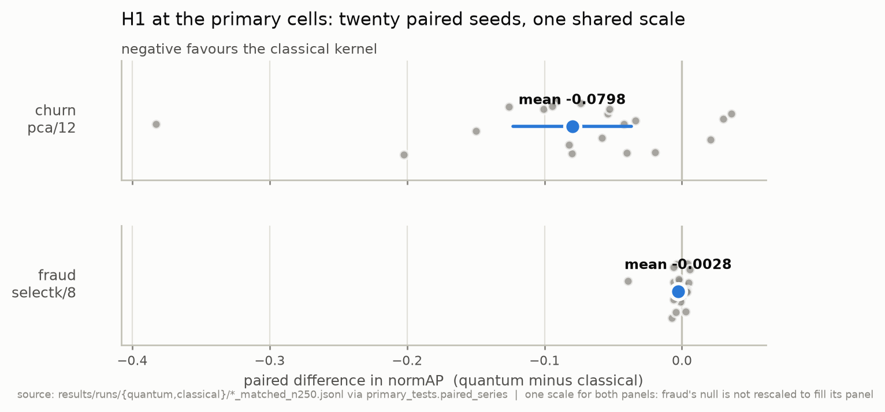
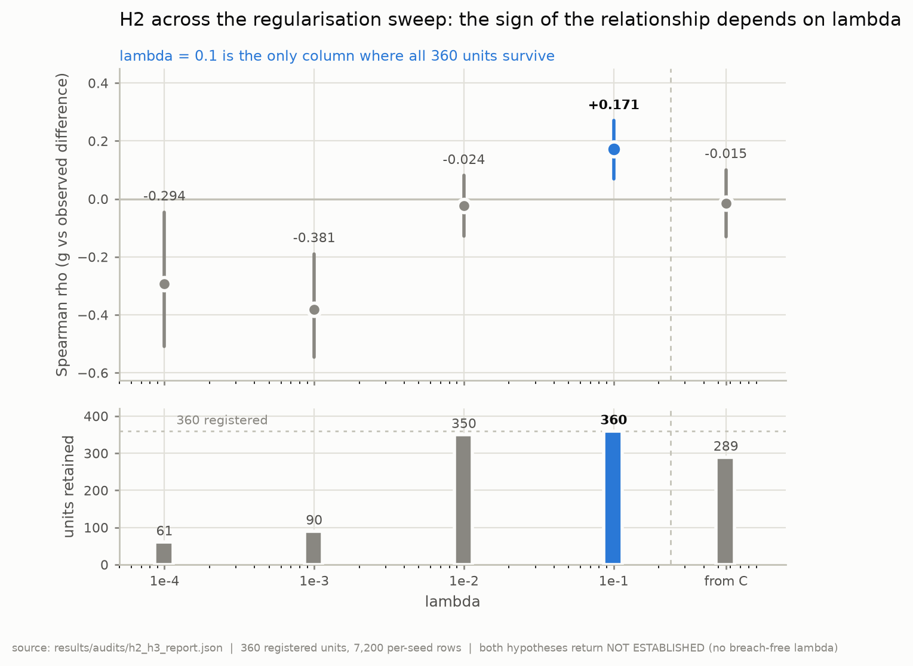
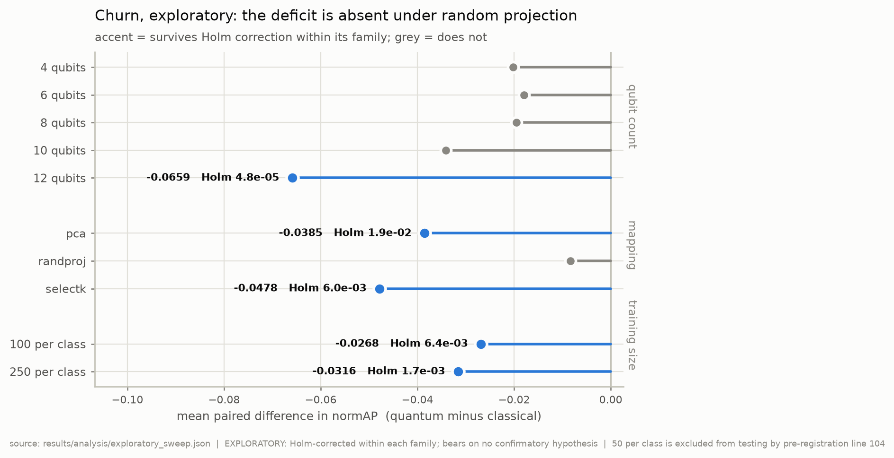

# Auditing a quantum-classical kernel comparison: a pre-registered null and what its own artefact will support

**GENERATED FILE. Do not edit.** Assembled by
`scripts/assemble_paper.py` from the section files listed below. Edit a
section and re-run; `--check` fails if this file has drifted from its
sources.

Assembled 2026-10-25T22:58:41+00:00 at commit `8719c0e`.

| section | source | sha256 |
| --- | --- | --- |
| Abstract | `docs/paper-abstract.md` | `e8de5d9407875e8c` |
| 1 | `docs/paper-introduction.md` | `1b7b13a3c91057f2` |
| 2 | `docs/paper-background.md` | `b77857d2ab111f69` |
| 3 | `docs/paper-design.md` | `e79e7703212f4ec9` |
| 4 | `docs/paper-results.md` | `b32aecd493a5dce3` |
| 5 | `docs/paper-protocol.md` | `fde9712da551c93d` |
| 6 | `docs/paper-discussion.md` | `18453af3c95068b7` |
| 7 | `docs/paper-deviations-pointer.md` | `1bfa12527bc78e11` |
| References | `docs/paper-references.md` | `fb91450b1d9fe1b1` |

---

# Abstract

Can a cheap pre-training quantity tell a practitioner not to bother with a
quantum kernel? We pre-registered that question on imbalanced business tabular
data, customer churn and credit-card fraud, across 360 units: three mappings,
five qubit counts, three training sizes, four quantum settings, twenty
seeds, statevector simulation only.

Neither primary cell shows a quantum advantage. On churn both endpoints reject
*against* the quantum kernel, a median deficit of 0.0659 normAP, clearing its
true minimum detectable effect by 1.31x. On fraud the test does not reject and is
reported as a bound: an advantage above 0.0063 normAP is excluded at 80% power.

For the geometric difference the registered rule returned **no verdict**, because
no regularisation column is free of ceiling breaches. That is the rule declining
to speak, not a finding that no relationship exists: at the largest
regularisation the null *is* rejected in the predicted direction, yet accounts
for 2.9% of rank variance and reverses sign across the sweep, so the quantity is
not usable as the screen it is offered as. A third rule, the source's own and one no
one had run, selects no parameter at all on 76.5% of units, returning nothing to
test.

Seventeen deviation records govern; the recovered pre-rewrite history is now
published, so every stored commit identifier resolves.

---

# Section 1 --- Introduction

A quantum-classical kernel comparison can be run carefully, pass every test its
authors wrote, and still not support the claim made from it. The ways such a
comparison fails are mostly not visible in its results: a metric compared across
two different nulls, a difference below the arithmetic resolution of the
pipeline, power measured on the wrong pairs, an asymmetric quantity carried into
code with its arguments the wrong way round. None of these shows up as an error.
Each shows up as a number.

This paper is about what a published artefact lets a reader establish, worked
through a pre-registered comparison that was built to answer a different
question and, in answering it, kept finding that the question behind it was
whether anyone could check.

---

## 1.1 The registered question

Huang et al.'s geometric difference is used as a screen: compute a cheap
quantity from two kernel matrices before training, and learn whether a quantum
kernel could outperform a classical one on this data. The practitioner's version
is narrower and more useful --- can a cheap number tell me **not to bother**?

This study registered that question on imbalanced business tabular data, where
the claim matters commercially and where the literature's benchmarks mostly are
not: Telco customer churn and credit-card fraud, 360 pre-registered units across
three feature mappings, five qubit counts, three training sizes and four quantum
settings, twenty seeds each.

---

## 1.2 What this paper reports

**A screen that is not usable, within its tested scope.** On those 360 units the
registered decision rule returns no verdict, because no regularisation column is
free of ceiling breaches under any of three $\lambda$ rules evaluated --- a rule declining
to speak, not a finding that no relationship exists. The third of those rules is
the one Huang's own source prints, and it turned out not to select a $\lambda$ at all on
**76.5%** of the units: on 81.3% of them his $\lambda$ rule and his $\sqrt{N}$ ceiling cannot
both be satisfied. Neither this study nor the peer-reviewed paper that inherited
the quantity had ever run it. At $\lambda$ = 0.1, the only column where all 360 units survive, the
null *is* rejected and in the predicted direction: rho = +0.17, p = 1.1e-03. That
relationship accounts for **under three percent of the rank variance** and
**reverses sign** across the regularisation sweep --- to -0.38 at $\lambda$ = 1e-3 --- so what
it appears to say depends on a parameter the practitioner chooses. A quantity
explaining three percent of rank variance, whose sign moves with a free parameter,
cannot tell a practitioner not to bother. Alongside it, no quantum advantage at
either primary cell: on churn a measured classical advantage, on fraud an
exclusion bound.

**An audit procedure that separates three things published work routinely
merges**: a measurement, a refusal, and an unsupported claim. A measurement
says what a quantity is. A refusal says the file cannot answer a question and
names which. An unsupported claim is an assertion its own artefact does not
license. The procedure's output is mostly refusals, and the paper is explicit
that a refusal is not a finding about the audited work.

**That merging has been measured, and the measurement is not this paper's.**
Bowles, Ahmed and Schuld sampled 55 arXiv papers using the word "outperform":
around 40% report a quantum model beating a classical one and three report the
reverse [5]. Their classical baselines are out-of-the-box rather than tuned and
still generally win. This study's are tuned under a pre-registered rule and
still win. That skew is why a pre-registered null is worth reporting at all,
and it was found after this study was designed and run, not before.

**A record format whose value is a property of the format.** A results file
carrying the fields in \S{}5.2 can be audited by a stranger in seconds, without the
pipeline that produced it, and the audit states which questions that file cannot
answer. This is the one claim here made without qualification.

**Source-to-implementation checking, with results.** Reading two papers at
source rather than in rendering, and comparing against their released code,
established that an asymmetric quantity is introduced in an appendix with its
arguments reversed relative to the main text and without relabelling, and that
the reversal propagates into a peer-reviewed paper whose equation, code and
stated interpretation all agree with one another. Applied to this project
itself, the same procedure established that **every one of its 15,120 result
records stores a code identifier no reader can resolve**.

---

## 1.3 What this paper does not claim

Stated here rather than left to the discussion, because each is a claim a reader
might reasonably expect and none is supported.

**Not that the geometric difference is invalid in general.** It was measured on
one grid, with one treatment of its regularisation parameter, on two datasets,
one of which is saturated at every training size tested. A quantity can be
uninformative where it was measured and informative elsewhere, and nothing here
separates those cases.

**Not that it carries no signal.** At the one breach-free regularisation column
the relationship is statistically detectable and runs in the predicted direction.
The claim above is about usability --- an effect of that size, with that sign
instability, cannot support a go/no-go decision --- and not about absence.

**Not that the audit detects defects in other people's pipelines.** On the one
occasion these checks met records they were not designed around, they produced
one measurement and eight refusals and **found no defect, nor were they looking
for one**. Whether they would detect an error in unfamiliar work is, on one
case, unevidenced either way.

**Not that the protocol is validated.** Every records-level and kernel-level
check was written after the defect it catches. The instrument has needed repair
seven times in public, three times because the tool was wrong and four times
because its authors stated something their own data does not support. Two of the
seven are
the same lesson twice: a superseded exclusion bound that the confirmatory script
printed for eleven days after the correction was written, pinned in place by a
regression test, and the registered adjudicator of grid adequacy, which printed
a verdict its own record had withdrawn for three weeks. Nothing in the protocol
caught either, because nothing in the protocol reads this project's own analysis
and reporting code.

**Not that the findings about published work are errors in their conclusions.**
They are statements that a claim cannot be checked from the published artefact
without going to source. In the orientation case the ambiguity originates
upstream of the authors who inherited it.

---

## 1.4 How to read this

Section 2 establishes what the geometric difference is, what its bound does and
does not assert, and how its arguments compose --- the derivation the rest
depends on. Section 3 traces the registered design and marks every subsequent
amendment. Section 4 reports the results, with its limitations in \S{}4.7. Section
5 is the protocol: what is
tooling, what is a reading procedure, what each costs, and \S{}5.6, which argues
against the contribution. Section 6 bounds what all of it supports. Section 7
points at the deviation records, which govern wherever they and the
pre-registration disagree.

A reader with limited time and a sceptical disposition should read \S{}5.6 and
\S{}6.3 first. They are where this paper says what its evidence will not carry.

---

# Section 2 --- Background: the geometric difference and its ordered arguments

**Draft, 3 October 2026.** Written under the framing recorded in D15.

This section states what the geometric difference is, what Huang's bound does
and does not claim, and what happens to both when an asymmetric quantity is
carried from a paper into code. Throughout, three things are kept apart and
labelled: **what a source states**, **what an implementation does**, and **what
this project verified by comparing them**. That separation is not stylistic.
The errors this section documents live exactly in the gap between the three.

---

## 2.1 The quantity

Huang et al. introduce the geometric difference to answer a question about
*model complexity* rather than about accuracy: given a function a model with
kernel K$^{1}$ can represent, how much complexity does a model with kernel K$^{2}$ need
to reproduce it?

**Source states** (arXiv:2011.01938, read from the e-print LaTeX; see 2.6 for
provenance). Equation (5):

> g(K$^{1}$ $\|$ K$^{2}$) = sqrt( $\|$ sqrt(K$^{2}$) (K$^{1}$)$^{-1}$ sqrt(K$^{2}$) $\|$_$\infty$ )

with $\|$$\cdot$$\|$_$\infty$ the spectral norm and the normalisation tr(K$^{1}$) = tr(K$^{2}$) = N, N the
number of training samples. The accompanying bound is

> s_{K$^{1}$} $\le$ g(K$^{1}$ $\|$ K$^{2}$)$^{2}$ $\cdot$ s_{K$^{2}$}

where s_K is the model complexity under kernel K.

Three properties follow from the printed definition and matter for everything
after.

**It is asymmetric.** The inverse falls on the first argument and the outer
square roots on the second. g(K$^{1}$$\|$K$^{2}$) and g(K$^{2}$$\|$K$^{1}$) are different numbers, and
nothing in the notation prevents one being used where the other is meant.

**It is a necessary condition, not a sufficient one.** Source states: *"if the
geometric difference is small, then a classical ML method is guaranteed to
provide similar or better performance"*, and *"if g_CQ is large we show that
there exists a data set with s_C = g$^{2}$_CQ s_Q"* with the quantum model
performing better. A large g establishes that **some** dataset exists on which
the quantum model wins. It does not establish that any particular dataset is
such a dataset.

**It is bounded.** With the trace normalisation above, g cannot exceed $\sqrt{N}$. A
value above that ceiling reports that the inverse is under-regularised, not that
the kernels are far apart.

The screening quantity is therefore **g(K_C $\|$ K_Q)** --- classical first, so the
classical kernel is the one inverted --- and it must be large for a quantum
advantage to be possible at all.

---

## 2.2 The regularised form, and a reversal inside the source

An exact inverse is unusable on an ill-conditioned Gram matrix, so the
regularised form is what anyone computes.

**Source states.** Appendix F, Equation (F19):

> g_gen = sqrt( $\|$ sqrt(K$^{1}$) sqrt(K$^{2}$) (K$^{2}$ + $\lambda$I)$^{-2}$ sqrt(K$^{2}$) sqrt(K$^{1}$) $\|$_$\infty$ )

and (F20):

> g_tra = $\lambda$ $\cdot$ sqrt( $\|$ sqrt(K$^{1}$) (K$^{2}$ + $\lambda$I)$^{-2}$ sqrt(K$^{1}$) $\|$_$\infty$ )

**The regularised inverse is on K$^{2}$, the second argument. In Equation (5) it was
on the first.**

**This project verified** that this is not an inconsistency, and the
identification matters enough to show rather than assert.

**Source states**, in Appendix F, the bound that accompanies F19:

> s_{K$^{2}$} $\le$ g_gen$^{2}$ $\cdot$ s_{K$^{1}$}

**The bound alone does not identify g_gen.** An inequality is satisfied by any
coefficient larger than the smallest one that works, so `s_{K^2} <= g_gen^2 s_{K^1}`
is consistent with g_gen being g(K$^{2}$$\|$K$^{1}$) and with its being anything larger. The
bound tells us which *direction* the appendix is reasoning in; it cannot tell us
which quantity g_gen *is*.

**The defining expressions do identify it.** Take F19's $\lambda$ $\to$ 0 limit directly.
The middle factor `sqrt(K^2)(K^2 + lambdaI)^-2 sqrt(K^2)` has eigenvalues $\mu$/($\mu$+$\lambda$)$^{2}$ over
K$^{2}$'s spectrum, which tend to 1/$\mu$, so that factor tends to (K$^{2}$)$^{-1}$ and

    F19(K^1, K^2)  ->  sqrt( || sqrt(K^1) (K^2)^-1 sqrt(K^1) ||_inf )   as lambda -> 0

Equation (5)'s template is: **invert the first argument, take outer roots of the
second.** Matching, the inverted matrix is K$^{2}$ and the outer roots are K$^{1}$, so the
limit is g(K$^{2}$ $\|$ K$^{1}$). Verified numerically on a constructed pair: at $\lambda$ = 1e-10
the two agree to a relative error of 7.5e-07, while the opposite orientation
g(K$^{1}$$\|$K$^{2}$) differs by a factor of 3.46, so the limit discriminates between them
rather than being satisfied by both.

So **g_gen = g(K$^{2}$ $\|$ K$^{1}$)** follows from the expressions, with the Appendix F
bound as independent corroboration of the direction. The ordered comparison is
reversed between the main text and the appendix, deliberately and for a stated
reason.

**What is still assumed.** Only that F19 is transcribed correctly, which the
e-print source in 2.6 establishes, and that the appendix intends F19 as the
regularised form of the same functional --- which its own $\lambda$ $\to$ 0 limit is the
evidence for.

**What is nonetheless true of the notation.** The appendix presents F19 as the
regularised geometric difference and does not relabel it as the reversed
comparison, while the main text directs the reader to the appendix for the
detailed derivation. A reader who takes F19 as "the regularised Equation (5)"
and substitutes K$^{1}$ = K_C, K$^{2}$ = K_Q obtains the reverse of the screening
quantity. **That is the trap this section exists to document**, and it is not
hypothetical: section 2.4 shows it closing on a peer-reviewed paper.

---

## 2.3 What $\lambda$ is, and what it is not

**Source states.** Huang reports g_gen *"with the largest $\lambda$ such that the
training error g_tra $\le$ 0.045"*, selected from the grid
{1e-5, 1e-4, 1e-3, 1e-2, 0.025, 0.05, 0.1}. **This project verified** that the
source is internally inconsistent on the boundary, writing $\le$ 0.045 in one place
and < 0.045 in the numerical-details passage; exact equality is unlikely to
bind in floating point, and the discrepancy is recorded rather than resolved.

**g is not a property of a kernel pair.** It is a property of a kernel pair *and
a $\lambda$*. The two constraints pull in opposite directions: g_tra increases with $\lambda$,
so the $\le$ 0.045 rule bounds $\lambda$ from **above**, while an unregularised inverse
drives g over its $\sqrt{N}$ ceiling, which bounds $\lambda$ from **below**. Reporting a g
without its $\lambda$ is reporting an incomplete quantity.

**Source states no relation between $\lambda$ and an SVM's C.** Huang prints no
SVM-to-kernel-ridge correspondence. The only $\lambda$-bearing objective is Appendix D's

> min_w [ $\lambda$$\langle$w,w$\rangle$ + $\Sigma$_{i=1..N} (residual_i)$^{2}$ ]

a plain sum, not a mean. **This project verified** the consequence: normalising
an SVC primal (1/2)$\|$w$\|$$^{2}$ + C$\cdot$$\Sigma$ loss so the per-sample loss carries coefficient 1
gives $\lambda$ = 1/(2C) against a summed risk and $\lambda$ = 1/(2CN) against a mean risk.
Which is correct depends on the objective the $\lambda$ belongs to, and Appendix D's
summed form points to 1/(2C). **Neither is Huang's procedure**, which selects $\lambda$
by the g_tra rule and not from C at all.

---

## 2.4 Source against implementation

The checks below are the ones this project's protocol specifies. They are
reported here because they are the worked example that motivates it.

### Flórez Ablan, Roth and Schnabel (2025)

**Source states** (arXiv:2503.05602, read from the e-print LaTeX). Their
Equation (4) is F19's structure --- regularised inverse on K$_{2}$, outer roots K$_{1}$ ---
cited to Huang. Their line 213 assigns **K$_{1}$ = K_C and K$_{2}$ = K_Q**. Their
interpretation follows Huang's main text exactly: *"only if g(K_C, K_Q) $\propto$ $\sqrt{N}$
holds, the necessary condition for potential quantum advantage is fulfilled"*,
and for values below that line, *"we are guaranteed that the classical model
provides similar or better performance"*. Their $\lambda$ is **1/(2C)** with
C $\in$ [32, 1024]; no g_tra rule appears anywhere in the source.

**Implementation does.** Their released code calls
`geometric_difference(K_train_poly, K_train_quantum, 1/(2*C_quantum))`, faithful
to their Equation (4). Paper, equation and code agree with one another.

**This project verified, by composition.** Since F19's g_gen is g(K$^{2}$$\|$K$^{1}$), and
their assignment is K$^{1}$ = K_C, K$^{2}$ = K_Q, the quantity they report as g(K_C, K_Q)
and compare against $\sqrt{N}$ is Huang's **g(K_Q $\|$ K_C)** --- the reverse of the
screening quantity.

**Stated as scope rather than as accusation.** Their reading of F19 is the
natural reading of an appendix that presents it as the regularised Equation (5).
The ambiguity originates upstream. What follows is that a g from their pipeline
and a g from any pipeline using Equation (5)'s orientation are reciprocal
quantities and cannot be compared without first fixing the ordering.

Two further observations from their released code, relevant to what a published
number means. Their ROC-AUC is computed on hard predicted labels ---
`decision_function` and `predict_proba` do not occur in the repository --- which
makes the reported quantity balanced accuracy rather than a ranking measure.
And `g_tra` is computed and stored throughout their pipeline and never compared
to anything; the 0.045 threshold appears once, in a docstring quoting Huang, and
is never applied.

### This project

**Implementation does.** `geometric_difference_regularised(K_C, K_Q, lam)`
computes

> sqrt( $\|$ sqrt(K_Q) sqrt(K_C) (K_C + $\lambda$I)$^{-2}$ sqrt(K_C) sqrt(K_Q) $\|$_$\infty$ )

which is F19 with K$^{1}$ = K_Q and K$^{2}$ = K_C, hence g(K_C $\|$ K_Q) --- the screening
quantity.

**Stated without credit-taking.** The orientation is correct, and no record from
the weeks in which it was written shows that the reversal in Huang's appendix
had been identified at the time. It was established on 1 October 2026, after
every g in this project had been computed. The implementation is right; the
reasoning for it was reconstructed afterwards, and the paper says so rather than
presenting the outcome as foresight.

**And one of this project's own rules is unsourced.** Its $\lambda$-from-C helper
returns 1/(2CN) with a docstring asserting the correspondence and citing
nothing. Against Appendix D's summed objective that is probably wrong by a
factor of N. The frozen $\lambda$ sweep that carries every reported result is unaffected;
the $\lambda$-from-C column is not, and the correction is recorded as an undecided
deviation rather than applied in passing.

---

## 2.5 Two algebraic facts that change how g reads

**This project verified** both; neither is stated in the sources consulted.

**g(K, K) $\ne$ 1.** For a kernel compared with itself, the regularised form gives
$\mu$_max/($\mu$_max + $\lambda$). So "g $\approx$ 1 rules advantage out" has a $\lambda$-dependent floor below
one, and a g near unity is not evidence of kernel identity.

**The classical factor is capped at 1/(4$\lambda$) for any kernel whatsoever.** With
A = sqrt(K_C)(K_C + $\lambda$I)$^{-2}$ sqrt(K_C), A's eigenvalues are $\mu$/($\mu$+$\lambda$)$^{2}$, maximised at
$\mu$ = $\lambda$ where the value is 1/(4$\lambda$). Hence g $\le$ sqrt($\|$K_Q$\|$_$\infty$ / (4$\lambda$)), and with K_Q
normalised to trace N a breach of the $\sqrt{N}$ ceiling requires

> $\|$K_Q$\|$_$\infty$ / N > 4$\lambda$

--- more than 40% of the quantum Gram's trace in a single eigenvalue at $\lambda$ = 0.1,
4% at 1e-2, 0.4% at 1e-3. Verified across 960 sampled observations: the bound is
violated zero times.

The consequence for reading any reported g: a large value at small $\lambda$ is
compatible with the classical kernel being badly conditioned relative to $\lambda$, and
says nothing on its own about the quantum kernel.

---

## 2.6 Provenance of the sources used here

Every statement labelled "source states" above was read from the arXiv e-print
LaTeX, not from a PDF rendering, a publisher's HTML, or any model's
transcription of either.

| source | archive SHA-256 | main file SHA-256 |
| --- | --- | --- |
| Huang et al., arXiv:2011.01938 | `b510654c6628...` | `maintext.tex` `ceded212c4b0...` |
| Flórez Ablan et al., arXiv:2503.05602 | `7ce99d754ecc...` | `main.tex` `1903926fe4b5...` |

This matters because earlier attempts in this project to obtain Huang's Appendix
F from rendered PDFs returned transcriptions that were **internally
contradictory on exactly the subscripts in question**, and one claim --- that
Huang's appendix contradicts his own main text --- was drafted on that basis and
withdrawn once the source was read. A claim about an equation's index placement
is only as good as the characters it was read from.

---

## 2.7 What this section establishes, and what it leaves open

**Established from source:** the definition and asymmetry of g; the bound's
status as necessary and not sufficient; the $\sqrt{N}$ ceiling; the reversal between
Equation (5) and F19 and the reason for it; Huang's $\lambda$ rule and its boundary
inconsistency; Huang's summed objective; Flórez Ablan et al.'s equation,
assignment, $\lambda$ and interpretation, and their code's fidelity to their equation.

**Established by this project's own analysis:** that their reported quantity is
the reversed comparison; g(K,K) = $\mu$_max/($\mu$_max+$\lambda$); the 1/(4$\lambda$) cap and the
resulting breach condition; that this project's own $\lambda$-from-C rule is unsourced.

**Left open:** whether 1/(2C) or 1/(2CN) is correct for this project's purposes,
and what follows for its $\lambda$-from-C column; both are recorded as an undecided
deviation and neither is used to revise any frozen analysis.

---

# Section 3 --- Design

**Draft, 4 October 2026.** Every figure below is traceable to
`docs/pre-registration.md` v1.0. **The registered design and its later
amendments are kept separable throughout**: registered values are given first,
amendments are marked with their deviation number, and \S{}3.9 tabulates every
movement so a reader can reconstruct the original design from this section
alone. The pre-registration is not edited; the deviations record is the
correction, as D6 established.

---

## 3.1 Data, tracks and seeds --- frozen, unamended

| | churn | fraud |
| --- | --- | --- |
| source | Kaggle `blastchar/telco-customer-churn` | Kaggle `mlg-ulb/creditcardfraud` |
| SHA-256 | `88be4b93...` | `76274b69...` |
| rows | 7,032 after cleaning | 284,807 |
| features | 30 | 29 (`Time` dropped) |
| positives | 1,869 | 492 |

**Seeds** 0 to 19, fixed in `qbench.data.SEEDS`, chosen from measured paired
variance: at ten seeds churn's minimum detectable effect was 0.0324, larger than
almost any effect this literature reports.

**Tracks.** *Matched* --- class-balanced subsample, mapped to `n_qubits`
dimensions, scaled to [0, $\pi$] --- is the hypothesis-testing track and **the only
one on which g can be computed**, since g requires both Gram matrices over the
same points. *Unconstrained* is a reference ceiling, reported separately and
never mixed into a paired test.

**Registered limitation, uncorrected.** Seeds resample one fixed dataset, so
splits overlap and paired differences are not strictly independent. Expected
shared test positives between two seeds: ~3 of 75 on churn (4%), ~11 of 75 on
fraud (15%, because 250 positives per class are drawn from only 492 available).
**The tests are therefore mildly anti-conservative on fraud**, which was stated
in advance rather than discovered afterwards.

---

## 3.2 The grid --- 360 units

Three mappings (PCA, Gaussian random projection, SelectKBest on mutual
information, seeded) $\times$ five qubit counts (4, 6, 8, 10, 12) $\times$ three training
sizes (50, 100, 250 per class) $\times$ four quantum settings $\times$ two datasets = **360
units**, each observed over 20 seeds: 7,200 per-seed rows.

**Quantum kernels, frozen.** PennyLane embedding kernels --- angle and IQP
embeddings, each at 1 and 2 repetitions --- on `lightning.qubit`. **All four run;
none is screened out before the sweep.** The registered reason is explicit and
is the design decision most worth preserving: an earlier version used g to
reduce the quantum grid, which is circular, because conditioning the experiment
on g and then testing whether g predicts the outcome cannot answer the question.
The cost of refusing that shortcut was about 46 hours of compute against 34.

**Classical kernels and grids, frozen.** Linear; RBF with gamma 1e-3 to 1e2 in
half-decades; polynomial with degree 2 to 5, scale-relative multiplier
0.1/1/3/10, `coef0` in {0, 1}; C from 1e-4 to 1e4. These were tested for
under-tuning by extension in both directions against a shuffled-label null. The
extension gained more on random labels than on real ones on every kernel and
both datasets, by factors of 2.0 and 5.0 on churn and 35.7 and 6.6 on fraud, so
they stand. \S{}3.7 records that the registered wording gives this as "five to
seven times", which is the polynomial-kernel figure and not the range.

**Tuning, identical across arms.** Nested cross-validation: 20 outer seeds,
5-fold stratified inner CV on the outer-train portion only.
`SVC(kernel="precomputed", class_weight="balanced")` for every kernel, classical
and quantum alike, **so folds, solver and selection rule are identical and only
the Gram matrix differs**. Selection on inner-CV average precision. Grid points
failing to converge within 1,000,000 iterations are excluded, never scored.

**Primary cells**, named in the registration so they could not be chosen later:
**churn = PCA at 12 qubits; fraud = SelectKBest at 8 qubits**, both at 250 per
class. These are the cells where the *classical* baseline is strongest, which is
deliberately the hardest test for a quantum advantage.

---

## 3.3 Hypotheses

**H1 --- no quantum advantage in the primary cell.** Per dataset, the paired
per-seed difference between best quantum and best classical kernel in the
pre-specified primary cell is zero. Two-sided, one test per dataset.

**H2 --- the geometric difference carries no information.** Across all 360 units,
g_$\lambda$(K_C$\|$K_Q) has no monotone relationship with the observed quantum-minus-
classical difference. Two-sided, though Huang et al.'s predicted direction is
positive. *The registration states plainly that "H2 is the reason this project
exists. H1 is the benchmark it is embedded in."*

**H3 --- g has no negative predictive value.** Among units with g_$\lambda$ below 2, the
observed difference is not bounded nearer zero than among units above it.

> **Amended, D13.** As registered, H3 was *"confirmatory but subordinate to H2
> and reported only if H2 is rejected."* H2 was not rejected, so under the
> registration as written H3's result should not have been reported. It was
> ungated in week 4 for a stated reason, the departure was not recorded in
> `deviations.md` until 29 September --- after H3's result was computed and
> published --- and D13 therefore offers the reader two readings and does not
> choose between them. \S{}4 reports H3 under both.

---

## 3.4 Endpoints and the decision rule --- unamended

Two co-primary endpoints, both from the same stored per-test-point decision
scores:

- **normAP** = (AP - chance) / (1 - chance), where *chance* is the exact
  expected average precision of a random ranking at that test-set size and
  positive count --- **not the base rate**. A random ranker scores 0.5516 on 30
  balanced test points and 0.5154 on 150, so comparing raw AP across test-set
  sizes compares two different nulls.
- **ROC-AUC**, which has an exact null of 0.500 at any sample size.

**Decision rule: intersection-union.** A hypothesis is rejected only if **both**
endpoints reject at $\alpha$ = 0.05, two-sided. No alpha correction, because the type I
error of "reject only if both reject" is at most that of either test alone.

This was chosen by measurement. The two endpoints' paired differences correlate
at a median of 0.818 to 0.947 across the matched arms, so requiring both costs
4 to 8% on the minimum detectable effect against 12% for splitting alpha across
a union rule.

**Test statistic.** Wilcoxon signed-rank on the 20 paired per-seed differences,
two-sided; paired t reported alongside as a sensitivity check. Records are
paired on the **test-label fingerprint**, asserted equal before any test runs;
a mismatch aborts the analysis rather than being worked around.

---

## 3.5 Power --- registered, and corrected

**As registered** (minimum detectable effect at 80% power under the
intersection-union rule, from the measured median paired sd in each arm):

| arm | paired sd | MDE single endpoint | MDE intersection-union |
| --- | --- | --- | --- |
| churn 50/class | 0.0604 | 0.0399 | **0.0427** |
| churn 100/class | 0.0424 | 0.0280 | **0.0298** |
| churn 250/class | 0.0241 | 0.0159 | **0.0171** |
| fraud 50/class | 0.0237 | 0.0157 | **0.0163** |
| fraud 100/class | 0.0136 | 0.0090 | **0.0094** |
| fraud 250/class | 0.0085 | 0.0056 | **0.0059** |

> **Amended, D6. Every row above is wrong, in the same direction, by 2.3x to
> 3.9x.** The registered standard deviations pair *classical kernels against
> each other* --- `power_analysis.py` was written in week 3, when the classical
> arm was the only arm that existed, so it could not have measured anything
> else. H1 tests a cross-arm difference, which is both larger and more variable.
>
> **Corrected, arm level** (the quantity the registered table reports):
> churn 250 $\to$ **0.0608**; churn 100 $\to$ **0.1005**; churn 50 $\to$ **0.1368**;
> fraud 250 $\to$ **0.0138**; fraud 100 $\to$ **0.0365**; fraud 50 $\to$ **0.0571**.
>
> **Corrected, primary cell** (the quantity an exclusion bound must quote):
> churn PCA/12 $\to$ **0.0608**; fraud SelectKBest/8 $\to$ **0.0063**.
>
> These are different quantities and D6 records that conflating them is how its
> own first version went wrong. **Every statement of the form "a null here would
> exclude effects larger than X" in the registration is superseded.**

**Registered as underpowered in advance.** The 50-per-class churn arm resolves
only 0.0427 and would need 74 seeds to reach 0.020; it is run for the shape of
the learning curve and **not** used for hypothesis testing. D6 makes this
further true --- it actually resolves 0.1368, three times coarser than the figure
that already disqualified it.

---

## 3.6 How g is computed

**As registered.** g in its regularised form, `geometric_difference_regularised`,
on normalised Gram matrices over the matched-track training set. $\lambda$ derived from
the classical model actually being compared against, via
`lambda_from_svm_C(C, n) = 1/(2.C.n)`, using the C that inner CV selected for
that cell. A $\lambda$ sweep reported alongside every value, because g is sensitive to $\lambda$
and an unregularised g exceeding its own $\sqrt{n}$ ceiling means the classical kernel
is under-regularised, not that the quantum kernel separates strongly.

> **Amended, D5.** The $\lambda$-from-C value is no longer the reported quantity. A
> **frozen sweep** at $\lambda$ $\in$ {1e-1, 1e-2, 1e-3, 1e-4} is reported with $\lambda$-from-C
> alongside, a **per-seed ceiling rule** excludes and counts any seed whose g
> exceeds $\sqrt{n}$ at a given $\lambda$, and **the registered conclusion stands only if sign
> and significance agree at every $\lambda$ with no ceiling breach**. D5 is a
> strengthening: requiring agreement across four $\lambda$ is strictly harder than
> picking one, and it cannot be gamed toward a positive result.
>
> **Amended, D7 and D8.** A unit's g is the **median** over surviving seeds, not
> the mean, with the IQR reported and a 10-seed minimum; the observed difference
> is averaged over **the same** surviving seeds; the above-precision-floor
> subset must agree; and a signed secondary is pre-declared.
>
> **Open, D14 (draft).** `lambda_from_svm_C` returns 1/(2$\cdot$C$\cdot$n) with a docstring
> asserting the correspondence and citing nothing. Huang prints no SVM-to-ridge
> relation, and his Appendix D objective is a summed residual, which points to
> 1/(2C). **The frozen sweep carrying every reported result is unaffected; the
> $\lambda$-from-C column is not.** D14 remains undecided and nothing has been
> recomputed.

**H2 test.** Spearman rank correlation between g_$\lambda$ and the observed mean paired
difference in normAP across all 360 units. Two-sided, $\alpha$ 0.05, single test;
per-dataset results are a pre-declared secondary.

**H3 test.** Units split at g_$\lambda$ = 2 --- **fixed in the registration and not tuned
afterwards** --- comparing |observed difference| above and below the split by
Mann-Whitney U, two-sided, $\alpha$ 0.05.

---

## 3.7 Controls --- registered, all executed

**Label-shuffled negative control.** The full quantum pipeline on permuted
labels at each primary cell. Expected ROC-AUC 0.500 and normAP 0; a consistent
excess in both beyond about two seed-level standard errors **halts the
analysis**. \S{}4 reports it clean on both datasets.

**Chance floor.** Every normAP against exact chance, never the base rate,
enforced in code and tested.

**Grid adequacy.** Any claim that a quantum grid is too narrow must be
adjudicated by `scripts/check_grid_edges.py` against a shuffled-label null.
**Hyperparameter edge flags alone will never justify widening a grid**, because
extension raises the maximum inner-CV score even when no point is better.

The registered wording puts that effect at "five to seven times the real gain on
the classical grids". The measurement supports its direction everywhere and its
range nowhere. Five and seven are the polynomial-kernel mean ratios, 5.0 on
churn and 6.6 on fraud; on the RBF kernels the ratio is 2.0 on churn and 35.7 on
fraud, so two of the four measurements fall outside the registered range and one
of them falls below it, understating the effect the rule exists to guard
against. The figures are in `results/analysis/grid_edges_*_both*.json`. **The
pre-registration's wording is unamended**, because changing a registered
document is a deviation and not a copy edit.

**Backend.** All quantum kernels on `lightning.qubit`, with a test asserting
`default.qubit` agreement to 1e-8. Cost is reported in circuit evaluations,
which are framework-independent; wall-clock is secondary and always labelled
with its backend.

> **Amended, D12.** The IBM hardware runs registered for weeks 7 to 8 were
> **never feasible as registered**, which is the wording D12's amendment
> requires in place of "dropped". The run needs 18,172,000 circuit executions,
> 113,575 per record across four settings, twenty seeds and two datasets,
> against an Open Plan allocation of ten minutes of QPU time per month: thirty
> times the budget at 1 ms per circuit and still three times over at 0.1 ms.
> Nobody established this for seven weeks, although the number that makes the
> timeline impossible was printed in every quantum record from week 4 and three
> weekly records each flagged the allocation as unchecked. No registered claim
> depends on them, and the protocol has consequently never been run against this
> project's own hardware records because there are none --- a gap in the
> protocol's evidence base, recorded as forgone rather than unimportant.

---

## 3.8 The registered exploratory set

Section 9 of the registration fixes the confirmatory set at **exactly three
tests**: H1 on churn, H1 on fraud, H2. No correction across the H1 pair, because
they are separate questions about separate datasets.

Everything else is exploratory --- *"the 15-cell sweep per dataset, the
qubit-count trend, the learning curve, the training-size comparison, per-mapping
breakdowns"* --- reported with **Holm-corrected p-values within each family**,
labelled exploratory in every table caption, with **no exploratory finding
described as evidence for or against H1 or H2**.

**Search-size asymmetry, declared in advance.** The classical side searches 396
grid points per cell, the quantum side 36 --- an order of magnitude wider. The
registration states this favours the classical side on inner-CV scores and not
on the outer test estimate, which is what the tests use, and requires the
comparison be reported **both** as best-quantum-of-four against
best-classical-of-three **and** per quantum setting against the best classical
kernel, so a reader can see whether the headline depends on the quantum side
getting to choose.

---

## 3.9 Every movement from the registered design, in one table

| # | what moved | direction |
| --- | --- | --- |
| D2 | a measured precision floor of ~1e-3 in AP added; differences below it reported as unresolvable | adds a constraint |
| D5 | reported g becomes a frozen $\lambda$ sweep with a per-seed ceiling rule; conclusion must hold at every breach-free $\lambda$ | strictly harder |
| D6 | the registered power table is wrong by 2.3x--3.9x throughout; corrected figures supersede it | weakens claims |
| D7 | unit g is the median over surviving seeds, IQR reported, 10-seed minimum | adds a constraint |
| D8 | observed difference averaged over the same surviving seeds; above-floor subset must agree; signed secondary pre-declared | adds a constraint |
| D12 | IBM hardware runs never feasible as registered: 18.17M circuits against a 600-second monthly allocation | removes planned evidence |
| D13 | H3 ungated from H2, declared after its result was published; two readings offered | weakens H3's status |
| D14 | `lambda_from_svm_C` corrected to 1/(2C) on an outcome-to-verdict mapping pushed before the re-run; the supplementary column's breaches fall from 2,893 to 979 of 7,200 and no verdict moves | corrects a defect, changes no result |
| D15 | the paper's organising contribution becomes the protocol | reframes, changes no analysis |
| D16 | Huang's own g_tra selection over his declared grid, specified in full before computation; a **prospectively specified follow-up analysis**, never confirmatory | computed, **outcome B3**: unsatisfiable on 76.5% of units, reported unresolved, no verdict moves |

**Nothing in this table changes a hypothesis, an endpoint, a decision rule, a
threshold, or a result.** D6 and D13 weaken what may be claimed; D2, D5, D7 and
D8 make the tests harder to pass; D12 removes evidence that was never collected;
D14 corrected one supplementary column's $\lambda$ definition under a pre-committed
mapping and left every verdict where it was; D15 is editorial; D16 ran under a
pre-commitment published first, returned B3, moved no verdict, and cannot by its
own terms become part of the confirmatory design.

---

# Section 4 --- Results

Every figure here is the registered analysis or an explicitly exploratory family.
Nothing in this section is a follow-up analysis: \S{}6.2a reports the one of those
there is, and it carries no verdict.

---

## 4.1 What was run

Two datasets, three training sizes, three feature mappings, five qubit counts,
four quantum settings, twenty seeds. 15,120 result records: 7,520 quantum,
7,440 classical, 160 negative-control. The geometric difference was computed
across all **360 registered units** and 7,200 per-seed rows.

Classical baselines were tuned over 396 grid points per cell against the quantum
side's 36, declared in advance as a search-size asymmetry that favours the
classical side on inner-CV scores and not on the outer test estimate, which is
what the tests use. Selection within a cell is by inner CV on training folds
only; the outer test set is touched once per (cell, seed, method).

---

## 4.2 H1: no quantum advantage on either dataset

Paired per-seed differences at the pre-registered primary cells, 250 per class,
20 seeds, intersection-union across both endpoints at alpha = 0.05.
*(`results/analysis/primary_tests.json`)*

**Figure 2** shows both datasets on one shared scale. Each figure stamps its own
source artefact into the image, so a reader can tell which run it came from
without trusting a caption.

**Churn, PCA at 12 qubits --- rejects, against the quantum kernel.**

| endpoint | mean | median | 95% CI | Wilcoxon p |
| --- | --- | --- | --- | --- |
| normAP | -0.0798 | -0.0659 | [-0.1229, -0.0367] | 8.20e-05 |
| ROC-AUC | -0.0292 | -0.0171 | [-0.0457, -0.0128] | 3.38e-04 |

Both endpoints reject and both favour the classical kernel. This is not a
failure to detect an advantage; it is a detected deficit of roughly 6.6 points
of normAP at the median, in the cell chosen because it was the classical
baseline's strongest.

**The margin, stated as D6 requires.** The effect clears the *registered* MDE of
0.0171 by 4.7x and its *true* primary-cell MDE of 0.0608 by **1.31x**. The
registered figure was computed from classical-versus-classical variance and is
wrong by 3.6x on this arm. Any phrasing of the form "well clear of what the arm
was powered for" is withdrawn.

**Fraud, SelectKBest at 8 qubits --- does not reject.**

| endpoint | mean | median | 95% CI | Wilcoxon p |
| --- | --- | --- | --- | --- |
| normAP | -0.0028 | -0.0014 | [-0.0072, +0.0017] | 0.245 |
| ROC-AUC | +0.0001 | +0.0005 | [-0.0017, +0.0019] | 0.823 |

Reported as a bound rather than as "no difference":

> **A true advantage larger than 0.0063 normAP at the fraud primary cell is
> excluded at 80% power.**

0.0063, not the 0.0059 section 8 registered; D6 corrects it to the primary
cell's own paired sd of 0.0095. The fraud *arm* as a whole is a different
quantity at 0.0138 and the two are never interchanged. The confirmatory script
printed the superseded 0.0059 for eleven days after D6 was written, with a
regression test pinning it; that is the fifth item in \S{}5.6 and it is recorded
rather than quietly corrected.

---

## 4.3 The negative control is clean

The full quantum pipeline on permuted labels at each primary cell, 80 records
over 20 seeds. *(`results/analysis/negative_control_quantum.log`)*

| dataset | ROC-AUC | from 0.500 | AP vs chance | from 0 |
| --- | --- | --- | --- | --- |
| churn | 0.5058 (sd 0.0493) | +0.52 sigma | +0.0040 | +0.45 sigma |
| fraud | 0.5001 (sd 0.0452) | +0.01 sigma | -0.0008 | -0.09 sigma |

Section 7's halt condition --- a consistent excess in both beyond about two
seed-level standard errors --- is not met. The comparison against *chance* AP
rather than the base rate matters: the gap of +0.0154 between them is expected
and is not leakage.

---

## 4.4 H2 and H3: the prediction is not established

*(`results/audits/h2_h3_report.json`, 360 units, 7,200 per-seed rows)*

**Figure 1** plots this table: rho with its interval above, units retained
below, because a rho from 61 units with 299 excluded is not the same evidence as
one from all 360.

| lambda | units | excluded | breaches | rho | p | 95% CI | rho$^{2}$ |
| --- | --- | --- | --- | --- | --- | --- | --- |
| 1e-1 | **360** | **0** | 4/7200 | +0.1712 | 1.11e-03 | [+0.069, +0.270] | 0.0293 |
| 1e-2 | 350 | 10 | 657/7200 | -0.0245 | 0.648 | [-0.129, +0.081] | 0.0006 |
| 1e-3 | 90 | 270 | 4574/7200 | -0.3814 | 2.09e-04 | [-0.545, -0.189] | 0.1454 |
| 1e-4 | 61 | 299 | 4972/7200 | -0.2938 | 2.16e-02 | [-0.508, -0.045] | 0.0863 |
| from C $\dagger$ | 289 | 71 | 2893/7200 | -0.0145 | 0.806 | [-0.130, +0.101] | 0.0002 |

**$\dagger$ The `from C` row was computed under the $\lambda$ rule D14 has since withdrawn**,
1/(2$\cdot$C$\cdot$n). Under the adopted 1/(2C) that column's ceiling breaches fall from
**2,893 to 979 of 7,200**, which still leaves it not breach-free. Its rho was
**not** recomputed: the verdict does not turn on it, and D14's outcome-to-verdict
mapping authorised reading the breach status and nothing further. The row stands
as the figure the published verdict was computed from, labelled, rather than
being silently replaced by a number computed after the fact.

**Both return `NOT ESTABLISHED (no breach-free lambda)`.** D5 requires the
conclusion to hold at every lambda at which no unit breaches its sqrt(n)
ceiling, and no column is breach-free.

**What that verdict is, said precisely, because three different statements are
easy to confuse here.** The registered rule returned **no verdict**. That is not
the same as the prediction having been tested and failed, and it is not the same
as finding no relationship. At lambda = 0.1 the null **is** rejected, in the
direction Huang predicts. The registered rule declined to speak because its
precondition --- a column in which no unit breaches its ceiling --- is met by none of
the columns.

Three things a reader needs in order to weigh that.

**It turns on four rows.** At lambda = 0.1 the column is otherwise complete ---
all 360 units present, none excluded --- and fails by **four breaching seeds out
of 7,200**, 0.056% of the observations, all from one cell and seed (churn,
n=100, selectk, 4 qubits, seed 7). The next-largest g/ceiling ratio anywhere is
0.9150 against those four at 1.075 to 1.093, so the dependence is discontinuous
rather than marginal. No tolerance was introduced and no seed excluded.

**The permissive reading also fails.** D5's text admits a second reading under
which the rule reduces to agreement across all five columns. That fails too,
because the sign of rho reverses: +0.17 at lambda = 0.1 against -0.38 at 1e-3
and -0.29 at 1e-4. Both readings land on the outcome D5 pre-declared for
disagreement: g's relationship to observed performance depends on the
regularisation chosen, which is a result about the metric.

**The substantive number is rho$^{2}$, not the verdict.** At lambda = 0.1, the only
column with a complete unselected population, **rho$^{2}$ = 0.0293**: the geometric
difference accounts for under three percent of the rank variance in observed
difference. A quantity explaining three percent of rank variance, whose sign
moves with a parameter the practitioner chooses, cannot tell a practitioner not
to bother. That is a claim about **usability**, not about absence, and it is the
finding the registered design called the practically valuable outcome to
establish either way.

**A third $\lambda$ rule was evaluated and returned nothing to test.** Huang's own g_tra
selection over his declared grid was specified in advance (D16) and run. It does
not select a $\lambda$ at all on 76.5% of the units, so it yields an incomplete column
and is reported as **unresolved** rather than as a negative result. \S{}6.2a gives
the measurement. Counting it, three $\lambda$ rules have been evaluated and none produces
a breach-free column; the third produces no column.

**H3 carries two readings and the reader picks.** Section 9 registers H3 as
subordinate to H2 and reported only if H2 is rejected. It was ungated in week 4,
for a stated and good reason, and the departure was not recorded until 29
September --- after H3's result had been computed and published. A reader who
accepts the commit ordering may read H3 as confirmatory under a departure
declared late but decided early; a reader who does not should read it as
exploratory. The paper does not choose for them.

---

## 4.5 The exploratory families

Exploratory throughout, Holm-corrected within each family, and no finding here
bears on H1 or H2. Each tested level averages the cells at that level **within
each seed** before testing, because cells at one seed share a train/test split;
levels carry 20 paired observations, not pooled rows.
*(`results/analysis/exploratory_sweep.json`, `results/analysis/primary_tests.json`)*

**Figure 3** shows the churn families.

**Churn.** The deficit survives correction under PCA (-0.0385, Holm 0.0189) and
SelectKBest (-0.0478, Holm 0.0060) and **not** under random projection (-0.0084,
Holm 0.3884). It survives at both tested training sizes (-0.0268 at 100,
-0.0316 at 250; the 50-per-class arm is registered as not for hypothesis
testing and is reported descriptively at -0.0315). In the qubit family only 12
survives (-0.0659, Holm 4.77e-05).

Per setting against the best classical kernel, all four lose after correction:
angle-r1 -0.0606 (Holm 0.0017), angle-r2 -0.0959 (5.34e-05), iqp-r1 -0.1011
(7.63e-06), iqp-r2 -0.3008 (7.63e-06). **The headline does not depend on the
quantum side being allowed to choose**, which is what section 9 required this
second reporting mode to show.

Across all 15 cells, two survive Holm: pca/12 at -0.0798 (Holm 0.0012) and
selectk/12 at -0.0918 (0.0082).

**Fraud.** Nothing survives anywhere. Largest magnitude +0.0045, no
Holm-adjusted p below 0.19. Three figures are **below D2's 1e-3 precision floor
and are reported as below the pipeline's resolution rather than as
measurements**: qubit 10 at -0.0008, random projection at +0.0003, training size
250 at -0.0000.

**Provenance of the per-setting and all-cells families.** Until 6 October both
were printed and never returned, so the only trace of them was three rounded
values per level in a tracked log, with no n, median, sd, confidence interval or
sensitivity t-test, and no commit, input digest or seed list. They are now
persisted with all of those. The figures above are unchanged: stdout was
byte-identical across that change on all six arms.

---

## 4.6 What these numbers do not support

Stated explicitly because each was reachable and each would have been wrong.

**No trend with qubit count.** The cell-level trend on churn is rho = -0.4692,
p = 0.0777 on n = 15 cells --- not significant. Only the 12-qubit level survives
Holm. "The deficit deepens with qubit count" is not supported, and the unit of
analysis here is the cell: an earlier version of a trend statistic in this
project correlated 300 records instead of 15 cells and every figure it printed
was voided.

**No claim about fraud's ROC figures against the AP floor.** D2's floor is
1e-3 *in average precision*. Fraud's ROC-AUC mean of +0.0001 is numerically
smaller but on a different scale, and flagging it would repeat the unit
conflation D6 records.

**No claim that g carries no signal.** At lambda = 0.1 the relationship is
statistically detectable and in the predicted direction. The claim in \S{}4.4 is
that it is not usable as a screen at that effect size with that sign
instability, which is a different and narrower statement.

**One structural reading, offered as interpretation.** On churn the deficit is
absent exactly where the classical baseline is weakest: random projection is the
mapping week 3 measured as climbing most with dimension, 0.3678 to 0.5481, and
it is the one mapping where the quantum kernel is not significantly behind. If
that holds up it inverts the usual framing, since the regime of interest is
supposed to be the one where classical methods already do well. It rests on one
dataset and one non-significant contrast.

---

## 4.7 Limitations, including two this study created

**The artefact was not available, and this conditions every limitation below
it.** The repository was **private from 17 September to 15 October 2026**, the
whole of the project's working life. It was found on 15 October, when a Software
Heritage save request failed with `visit_status: not_found` and an
unauthenticated GitHub query returned 404; the author's pushes had always
succeeded because the author is authenticated. **No reader could have checked
any claim in this study while it was being made.**

The consequence for ordering is the one that matters. D14 required its chosen
option and outcome-to-verdict mapping to be "committed and pushed before any
recomputed value is examined", and D16 was "specified in full and pushed before
it was computed". Both happened. **Neither was public.** A push to a private
remote does leave server-side receipt times the author does not set, which a
purely local commit does not, but those times are not exposed to a reader, not
verifiable by one and not citable. So every phrasing of the form *declared
publicly* or *published before the run* is **withdrawn** in favour of *committed
and pushed to a private remote before*, and the pre-commitment discipline here
is something the author practised rather than something a reader can check.

**Visibility was changed on 15 October 2026**, after two Software Heritage save
requests (2558108, 2558127) had failed with `visit_status: not_found` against the
private origin. A third request succeeded at **01:33:06 UTC on 15 October 2026**,
`visit_status: full`. A fourth was taken three minutes later. **There are two
snapshots and the reason is structural:**

    swh:1:snp:bdbf43089b1ed77f5ec9307e11f5c255dddc84dd   01:33:06, repository at 5464088
    swh:1:snp:c19a29f94639c2ea87347ae40a3d949919a75005   01:36:58, includes the commit recording the first

**A snapshot cannot contain its own citation.** The first attests the repository
as it stood when visibility changed, before any record of the archive existed; a
reader resolving it finds a \S{}4.7 that does not mention it. The second contains
the commit that records the first, so it is the one to resolve to read this
paragraph as archived. The second is in turn cited by a commit made after it, and
**that regress does not terminate** --- it is stopped here by choosing to stop, not
by completeness, and the same is true of any self-referential archive citation.

**These are the first externally verifiable facts in this study.** A third party now
attests that this repository's content existed in that exact form at or before
that instant, at a time no one here controls. Everything below describes what a
reader can do from that moment on.

**What the snapshot does not do**, stated because an archive identifier invites
being read as more than it is. It **backdates nothing**: every result, every
deviation record and every pre-commitment in this paper predates it and remains
externally unattested. It does **not** repair D11, and could not: both snapshots
capture the public refs as they stood on 15 October, six days before
`prerewrite-20260925` was published, so neither archive contains the commits the
result records name. Those identifiers resolve from the repository itself and
not from the archive. What the snapshots establish is forward-looking only: from
01:33 on 15 October 2026, a claim about this repository's state can point at
something outside this machine.

**Provenance, and the decision that was open until 21 October 2026.** Every one
of the 15,120 result records stores a `git_commit` that a history rewrite on
25 September 2026 removed from the public repository. The recovered branch
`prerewrite-20260925` was **published on 21 October 2026**, tip `b5bf0431`, and
all five identifiers this study depends on are reachable from it: `a8bafbb` and
`61f7db9`, which `pre-registration.md` cites as its anchor, and `0b796a3`,
`2cf7ec7` and `0b2aef4`, which the records store. **A reader can now compute the
tree of a stored hash directly.** The annotated tags `records-0b796a3`,
`records-2cf7ec7` and `records-0b2aef4` remain as a convenience and are no
longer the only route; a tag records an assertion, and the assertion is now
checkable against the object it is about.

**What that closes and what it leaves.** It closes the binding: a record names a
commit, the commit is public, its tree can be computed by anyone. It closes
nothing about **ordering**. Commit dates are author-set, both histories are
author-controlled, and the two Software Heritage snapshots were taken six days
before this branch was public, so neither contains it. A re-run from current HEAD
still produces evidence about the current code rather than authenticating the old
records. The limitation that remains is the one in the next paragraph, and it is
the one that was always the larger of the two.

**The cost, stated rather than minimised.** Publishing restored to the public
repository the AI co-authorship trailers the rewrite removed, across the
branch's 25 commits. `main` already carried **twenty** commits with those
trailers, reinstated by default in late September and then deliberately left in
place and documented rather than rewritten, and this repository's README
declares the assistance in prose. The decision therefore conceded in public what
the record had already conceded four weeks earlier. It is recorded as an
amendment to D11.

**No external timestamp, and no external reader either.** This study is not
registered at OSF and has **no Software Heritage snapshot predating its
results**. The first of those is a **decision** rather than an omission, taken
on 21 October 2026 and recorded against D11: a registration created now would
be dated three weeks after every result and after this paper was written, and
attaching it to a document whose header once claimed an earlier date would read
as backdating, converting an honest absence into an apparent misrepresentation.
Two weekly reports had listed it as outstanding work without reconciling that
against the reasoning already in D11.

Its ordering evidence is an author-controlled history, rewritten once on
25 September, on a remote that no one else could read until 15 October, with
no external attestation at any point. Every ordering claim in this paper,
including the claims in D13, D14 and D16 that a decision preceded a result, rests
on evidence of that class. **A reader who declines to accept it is left with
nothing**, and that is the honest statement of the position rather than a
reason to discount the claims selectively.

**No hardware.** The IBM runs registered for weeks 7 to 8 were dropped as
infeasible (D12) and no claim in this paper depends on them.

**The 50-per-class arm** resolves 0.1368, three times coarser than the 0.0427
that already disqualified it from hypothesis testing.

**One dataset is saturated.** Fraud's classical baseline sits at 0.9659 normAP
at the primary cell and is saturated at every training size tested, so one of the
two datasets could not have shown an advantage had one existed.

**The figures, and a reversed decision.** The three PNGs above are **committed**,
by name, as exceptions to the `.gitignore` rule that excludes
`results/figures/*`. An earlier draft excluded them on the ground that outputs
are regenerated rather than versioned and that
`PYTHONPATH=src python scripts/make_figures.py` reproduces them deterministically
from committed artefacts. That reasoning is sound as far as it goes and the
regeneration command still works. It was reversed for one reason it did not
address: **determinism there rests on an unpinned plotting library**, so a reader
on a different matplotlib gets a visually different figure, and a figure a paper
references but does not ship is the same defect class as a commit hash that does
not resolve. Three PNGs are 319 KB. The SVG sources remain excluded, being
regenerable and read by nothing in the paper.

**Checks this study has not completed**, listed rather than left implicit.

**The mutation harness now reads every test file, and what it reveals is worse
than what it fixed.** Until 15 October it was hardwired to one test file, so
mutants for the F20 diagnostic, the $\lambda$ correction and the exploratory families
had to be run by hand. Those four are now in the suite and all **37** mutants are
killed by the test that names each one, across five source files and four test
files. But the coverage report was also scanning only the files that already had
mutants, which hid every file with none: corrected, it reads **37 of 395 test
functions**, not the 34 of 70 the old report implied. **Fifteen of nineteen test
files have no mutant at all**, including `tests/test_audit.py` and its 76
functions --- the tests for the audit tool \S{}5 is about. So the honest statement is
that this project has demonstrated non-vacuity for 9% of its test functions and
has not examined the rest.

**The one check that had no mutant now has two.** `select_lambda` in
`scripts/gtra_sweep.py`, which implements D16's selection rule, was exercised
only by that script's own control F and not by pytest. The harness maps each
mutant to a pytest node, so a rule with no pytest test cannot have its
non-vacuity demonstrated at all, and control F runs inside a sweep that takes
hours. `tests/test_gtra_sweep.py` now pins the rule, and two mutants target it:
taking the smallest admissible $\lambda$ rather than the largest, and reading the
threshold as strict where D16 fixed it inclusive. Both are killed. One of those
tests covers a case control F does not --- an admissible set with a hole in it,
where an implementation scanning upward for the first violation would agree with
control F on every monotone input and still select the wrong $\lambda$.

**The figures check covers three of this paper's numbers.**
`scripts/check_paper_figures.py` re-derives the churn and fraud primary-cell
exclusion bounds from `results/audits/d6_table.json`, and D16's share of units
with no admissible $\lambda$ from the 7,200 stored unit records, comparing each at the
precision this paper states rather than within a chosen tolerance. Everything
else it reports as **not checked**, against a denominator of every decimal
figure in this paper, which it counts on each run rather than quoting from here
so that the figure cannot go stale the way this section's own items did. The
denominator is left unfiltered on purpose: it includes section
cross-references, arXiv numbers and DOIs that are not measurements, and
filtering those by pattern would be a guess, which is what made the mutation
coverage above overstate itself. Among the figures it does **not** cover are the
H2 rank correlation and D16's elasticities, whose quantities have not been
mapped to an accessor in any stored record. \S{}5.6 records that this check would
not have caught any of the defects that motivated it.

**One item unchanged, and two closed since.** **Two Software Heritage snapshots
now exist**, `swh:1:snp:bdbf43089b1ed77f5ec9307e11f5c255dddc84dd` at 01:33:06
and `swh:1:snp:c19a29f94639c2ea87347ae40a3d949919a75005` at 01:36:58 UTC on
15 October 2026, after two earlier requests failed against the private origin. It postdates every result here, so it bounds the provenance gap
rather than closing it; the first paragraph of this section states what it does
and does not establish.

The other two are closed, and one of them was described wrongly here. The
`descriptive_only` rows in the exploratory output now carry the
`below_d2_floor` field the tested rows carry. The grid adequacy check was said
to have "not been extended since week 9", which misplaced the gap: the
measurement was complete and correct in week 3 and reproduces bit-identically
under current code, and what was missing was that its adjudication lived only in
prose. `scripts/check_grid_edges.py` went on printing the rule week 3 had
withdrawn, reporting UNDER-TUNED on fraud where the registered comparison
against a shuffled-label null returns adequate on both datasets. The registered
comparison is now what the script computes and what its output records; \S{}5.6
counts the episode.

---

# Section 5 --- The protocol

**Draft, 4 October 2026.** Written under the framing recorded in D15, which
makes this section the paper's contribution rather than its methods appendix.

A comparison of quantum and classical kernels can be run carefully and still
mean nothing, because the ways it fails are not visible in its results. This
section specifies checks that are, says what each costs, and is explicit about
which of them is implemented tooling and which is a procedure performed by hand.

It audits **method, not results**. It never reports which model won. A failure
means a conclusion drawn from a file is not supported *by that file*; it does
not mean the conclusion is wrong.

---

## 5.1 Three parts, and only one of them is a tool

D15 describes this project's contribution as a process for checking equation
ordering, implementation fidelity, provenance, and the limits of the resulting
evidence. **The implemented protocol covers the fourth and part of the second.**
Saying so first is the point; a section that let the framing imply more tooling
than exists would be the error the protocol is for.

| part | what it checks | status | exercised on |
| --- | --- | --- | --- |
| **A. The record audit** | what a results file does and does not support | **implemented**: `scripts/audit.py`, `tests/test_audit.py`, a documented record format and a hook interface | this project's six arms; one foreign pipeline |
| **B. Source to implementation** | that a paper's printed equation, its stated interpretation, and its released code are the same thing | **procedure, not tooling**. No script. | two published papers |
| **C. Provenance** | that a result's stated origin can be resolved by a reader | **procedure, not tooling**. No script. | this project, against itself |

Parts B and C are written up here because they found things, and because a
reader deciding whether to repeat them deserves the cost. They are not claimed
as software.

---

## 5.2 Part A --- the record audit

### The format

One JSON object per line; a record is one model, scored once, on one
train/test split. Nothing in it is specific to quantum kernels. Required:
`method`, `seed`, `n_train`, `n_test`, `test_base_rate`,
`test_average_precision`, `test_roc_auc`. Strongly recommended, with each
check degrading to SKIP and naming what its absence makes unanswerable:
`test_label_fingerprint` (the test labels hashed **in order**, without which no
paired test can be verified, only assumed), `shuffled`, `final_converged`,
`inner_score`.

The format is the load-bearing part. **A file that does not record enough to be
checked cannot be checked by anyone**, and the claim here is not that a
comparison lacking these checks is wrong --- it is that nobody, including its
authors, can tell.

### What it asserts, and what it costs

Tier 1 runs from the records file alone: schema, chance correction, negative
control, pairing integrity, solver health, unit of analysis, statistical power,
precision floor, multiplicity, tuning symmetry, cross-arm comparison, selection.
**Cost: seconds, no access to the original pipeline.** This is the tier that
makes auditing a stranger's comparison cheap.

Tier 2 asks about the kernel, which a results file does not contain, so the
pipeline supplies three optional functions --- `gram`, `training_data`, `refit` ---
and the audit imports nothing of its own. It covers kernel conditioning and
classical surrogate equivalence. **Cost: kernel recomputation, which is the
dominant expense**; `--hook-sample` is the knob, and readings are indicative by
construction. They say *run the full analysis*, not *publish this*.

One check needs a re-run rather than a hook: **grid adequacy against a shuffled
null**, because widening a grid raises the best inner score even when nothing is
better, so hyperparameter edge flags never justify it on their own. **Cost: a
second full execution of the pipeline on permuted labels.** It is the most
expensive check here and the one most often skipped.

### What distinguishes these from diagnostics

Published work in this area is statistically careful. Kakavand et al. apply
paired Wilcoxon with an exact permutation fallback for small n, Friedman with
post-hoc Nemenyi, and both Benjamini-Hochberg and Bonferroni; their kernel
diagnostics compute condition number, effective rank, PSD-ness and the full
eigenspectrum; their preprocessing is leakage-safe and their two arms share one
hyperparameter grid --- a symmetry this project's registered design did not have.
**That is more statistical care than this project had at the end of week 4**, and
the protocol does not claim otherwise.

What is added are **decision rules rather than diagnostics**: a measured
reproducibility floor below which a difference is reported as unresolvable
rather than small; classical surrogate equivalence expressed in endpoint units
rather than as a distance in kernel space; shuffled-label controls adjudicated
against both a sigma bar and that floor; cross-arm rather than within-arm power,
which differ by 2.3x to 3.9x in this project's own data. Computing a condition
number is ordinary. Refusing a verdict on the strength of one is not.

---

## 5.3 Part B --- source to implementation

**No tooling exists for this.** It is a reading procedure, performed twice, and
it found something both times.

**The procedure.** Obtain the paper's source rather than a rendering --- for
arXiv, the e-print LaTeX. Record the archive and file hashes. Locate the
equation as printed, with its subscripts. Locate the prose that assigns its
arguments. Locate the corresponding call in the released code. Then compare the
three, and label every resulting statement as what the source states, what the
implementation does, or what the comparison establishes.

**Why source rather than a rendering.** Earlier attempts in this project to read
Huang's Appendix F from PDF renderings returned transcriptions that were
internally contradictory on exactly the subscripts at issue, and a claim that
the appendix contradicted its own main text was drafted on that basis and
withdrawn when the LaTeX was read. **A claim about an equation's index placement
is worth no more than the characters it was read from.**

**Cost.** One download, the hashes, and an afternoon per paper. No compute. It
is the cheapest part of this protocol and it caught the largest thing.

**What it found** is in section 2: that Huang's F19 is the reversed ordered
comparison relative to Equation (5), that Flórez Ablan et al. read it the
natural way, and that the quantity they compare against $\sqrt{N}$ is therefore
`g(K_Q||K_C)` where the screening quantity is `g(K_C||K_Q)`. It also found, in
their released code, ROC-AUC computed on hard predicted labels --- making the
reported quantity balanced accuracy rather than a ranking measure --- and `g_tra`
computed throughout and never compared to anything.

**What it does not establish.** Nothing about whether their conclusions are
wrong. An ambiguity inherited from an upstream appendix is a scope statement,
not an error attributed to the people who inherited it.

---

## 5.4 Part C --- provenance

**No tooling exists for this either.** The procedure is: take the identifier a
result record stores for its own origin and try to resolve it as a stranger
would, from the public artefact alone.

**Cost.** Minutes, and it requires no access to anything the authors have not
already published --- which is the point.

**What it found, run against this project.** Every one of the 15,120 result
records stores a `git_commit` that does not exist on the public repository. A
history rewrite invalidated all three stored hashes; they resolve only from a
branch recovered from a folder that had been queued for deletion. A
tree-identity mapping to public counterparts exists, and it reduces what must be
taken on the author's word without removing it: a reader can verify that the
counterpart carries the stated tree and cannot verify that the stored hash ever
did.

The project's own reproducibility section commits that every record stores its
commit. **That commitment was satisfied in form and unverifiable in practice for
nine days before anyone checked**, and it was checked only because a previous
amendment had documented the same trap for different hashes.

**The loss, bounded precisely.** What a reader cannot do is **independently bind
a historical result record to the code that generated it**. That is the whole of
it, and it is not nothing: they cannot confirm that the analysis code at run
time is the code now published, nor diff the two to see what differs.

**What remains independently checkable**: every analysis script, in full; the
data provenance, which is separate and unaffected, with sources and checksums in
`data/README.md`; the records themselves, which are intact; and the public half
of the tree-identity mapping --- that each named counterpart on `main` carries the
stated tree.

**What a re-run does not do.** Executing the current pipeline on the current
data produces **new evidence about the current code**. It does not authenticate
the old records, because agreement would be consistent with the code having
changed in ways that do not alter these particular outputs, and disagreement
would not distinguish a code change from a data or environment change. A
reproduction and an authentication are different operations, and only the first
is available here.

---

## 5.5 What this protocol does not do

It does not tell you whether a quantum kernel is better. The hook widens what it
can see and does not change that: a surrogate reading is about the kernel, never
about which model won. It does not detect a wrong kernel implementation, a
mis-specified feature map, or a dataset leaking labels through preprocessing. It
cannot see analysis performed outside the file it is given. **A clean report
means the file supports the kind of claim being made, not that the claim is
true.**

Parts B and C are not automatable as written. Part B requires judgement about
what an equation means; part C requires knowing what a given repository's
history has been through.

---

## 5.6 The evidence for this protocol is weaker than its instance count suggests

This is the section a reader should weigh most heavily, and it argues against
the contribution.

**Every Tier 1 and Tier 2 check was written after the defect it catches.** The
protocol's own first section says so: each exists because a specific reading
went wrong here, usually after passing review. Seventeen deviation records and a
list of caught mistakes are **not** evidence that a tool catches a stranger's
mistakes. They are evidence that this project eventually noticed its own.

**The prospective evidence is one case, and what it shows needs stating
precisely.** In week 6 the audit was run against Kakavand et al.'s public
Zenodo deposit through an adapter. It produced **one measurement and eight
refusals**: kernel conditioning across all six deposited `ibm_fez` Grams, worst
4.5e+05, against this project's own 7.8e+19 to 1.1e+33; and eight statements of
what the deposit cannot answer --- four required fields absent, so chance
correction, power and the precision floor each name their gap; no classical arm
in the hardware phase, so cross-arm has nothing to pair; one seed, so
unit-of-analysis warns and power cannot speak; no `inner_score`, so selection
cannot be shown.

**It found no defect in their pipeline, and was not looking for one.** The
week-6 record states it directly: *"None of this is a criticism of their work:
it is a map of what a reader can and cannot verify from that deposit."*

**The criterion by which this counts as useful, stated rather than assumed.**
The output is useful if it changes what a reader knows about the deposit's
evidential reach. Before the run, a reader could not say which questions those
records could answer; after it, they could, in seconds, without the originating
pipeline. That criterion is met. **It is a claim about a reader's state of
knowledge, not about the quality of the audited work**, and it does not
generalise to defect detection, because on the only occasion these checks met
foreign records they detected none.

Parts B and C add two cases apiece, but both were performed by the same party
that wrote the procedures.

**Seven things have gone wrong in public, and they are two different kinds.**
Collapsing them under one word was itself imprecise.

*Defects in the instrument (three).* On its first contact with real records the
tool required a field this project's own pipeline never emitted, collapsed
fifteen configurations into one, and **silently changed three answers**. The
first audit run against real records then found four further defects, **all four
in the checks rather than in the records**, with the full test suite passing on
every one.

The third is the registered adjudicator of grid adequacy. Section 7 of the
pre-registration names `scripts/check_grid_edges.py` as what decides whether a
grid is too narrow, and requires the decision to be made against a
shuffled-label null. The script computed that null when asked, printed it, and
told the reader to do the subtraction by hand, while on a real run printing a
verdict derived from the ratio of the gain to the minimum detectable effect.
Week 3 had already recorded that ratio as a defect, because the maximum over a
grid grows with the number of points searched and so cannot separate an optimum
lying outside the grid from a surface too noisy to rank; the threshold week 3
describes as pre-declared existed nowhere in the code. The committed log
`results/analysis/grid_edges_fraud.log` therefore carried the verdict
**UNDER-TUNED, widen the grids and re-run week 3**, where the registered
comparison returns adequate. The correct answer was in the week-3 record
throughout and the project acted on it, so no result here rests on the wrong
verdict; what was published was an instrument contradicting its own record for
three weeks. Found on 18 October 2026 by reading the script, not by any check in
this protocol.

*Claims its authors made that their own data does not support (four).* It asserted from the
manuscripts that two published benchmarks performed none of five checks; when
the deposit behind one was read, **six of seven claims in that paragraph were
wrong or misleading**. It declared four checks unrunnable when three were not ---
one needed nothing at all. And the confirmatory script printed a **superseded
exclusion bound for eleven days**: `scripts/primary_tests.py` quoted the
registered 0.0059 for fraud's primary cell while every document here quoted
D6's corrected 0.0063, the committed analysis log carried the wrong figure, and
a regression test asserted it. Nobody re-read the code after writing the
correction. It was found on 6 October 2026 while refactoring an unrelated
function, by inspection and not by any check in this protocol. And the
pre-registration gives the measured advantage of extending a grid on random
labels over real ones as **five to seven times**, which is the
polynomial-kernel figure: on the RBF kernels the ratio is 2.0 and 35.7, so two
of the four measurements fall outside the stated range, one above it and one
below. Week 3 had the full four-row table in front of it when that sentence was
written. **This fourth one differs in kind from the three before it**, and the
difference does not favour it: those asserted things nobody had checked, while
this took a measurement that had been made correctly and stated it more broadly
than it supported. Nothing in a reader's view distinguishes a generalised
measurement from a measured one. The rule that figure supports is unaffected,
the direction holding on every kernel and both datasets; D17 records it and the
registered document is not edited.

**None of the seven is an audited pipeline failing an audit.** A reader who takes
this section as evidence that audited work fails these checks has read it as it
was first written and not as it is meant. The two kinds matter differently: the
first says the instrument needed repair, the second says its authors committed
the error the instrument exists to prevent.

**A further item, about Tier 2 rather than about either kind.** On a partial
sample of two of the six foreign Grams, the conditioning check read 1.7e+04 ---
**understating the worst case by a factor of 26**. Two things should be kept
apart here. The numerical miss was corrected only by running the full six. What
printing the sample count achieved was narrower: it exposed that coverage was
incomplete, so the reading was known to be partial. **It did not establish the
true worst case and could not have.** That is the honest limit of indicative
sampling, and it argues for treating `--hook-sample` readings as a prompt to run
the full analysis rather than as a figure.

**A bounded gap the fifth item exposes, and two more beside it.** The superseded
bound was found by inspection, not by a check. So were two latent defects in this
project's own reporting code, found the same day: a Holm family size printed as
the literal 4 rather than computed, and a table headed "all cells" that silently
skipped cells with too few paired series. Neither of those two ever produced a
wrong value, so neither joins the count above; the superseded bound did, so it
does. The sixth item above, the grid adjudicator, was found the same way. What
all four share is the route. **Tier 1 reads records and Tier 2 reads kernels.
Nothing in this protocol reads this project's own analysis and reporting code
for claims the data does not support**, which is where all four lived.

**What now exists, and what it would not have caught.** Since 19 October 2026
`scripts/check_paper_figures.py` re-derives figures this paper prints from the
stored records, and a test asserts that the exclusion bound
`scripts/primary_tests.py` prints matches the copy `scripts/audit_sweep.py`
checks against regenerated data. Neither is part of the protocol, and the
figures check would have caught **none of the four items above**. All four were
divergences between code and record in which this paper's prose was correct or
unaffected: the fifth repair had `primary_tests.py` printing 0.0059 while every
document here quoted 0.0063, so a check reading the paper against the records
would have passed it without comment. What would have caught it is the narrower
assertion, the one tying a printed figure to the copy that is checked against
data --- which exists only because the fifth repair was corrected at its value and
not at the structure that produced it. \S{}4.7 states how much of this paper the
figures check covers, which is very little.

**A further group found by reading and deliberately not counted.** Three
separate generators defaulted to not recording their output: the `.docx`
exporter wrote no provenance, `scripts/exploratory_sweep.py` required `--out`
with no default, and the paper existed only as section files until an assembler
was written for it. An unrecorded output is an absent value rather than a wrong
one, so none of these joins the count above. One of them did publish a stale
artefact: on 15 October 2026 `docs/deviations.docx` was sixteen days and roughly
1,400 record lines behind its source, because generating the document was a step
somebody had to remember. `scripts/check_docx_fresh.py` now stores the SHA-256
of each export's source and fails when it moves. **It does not hash the
generator**, so a change there leaves every export reported current while its
output would differ, and **it does not look inside the document**, so an export
edited by hand after generation also reports current. Both gaps are stated here
rather than closed.

That last fact is the honest summary of what this protocol is worth. **A green
test suite was not evidence that a measurement tool measured anything**; reading
a report on real data was. Any reader adopting these checks should expect the
same, and should treat the first run against their own data as a test of the
checks rather than of their pipeline.

---

## 5.7 The one claim made without qualification

A results file in the format of 5.2 can be audited by a stranger in seconds,
without the pipeline that produced it, and the audit will say which questions
the file cannot answer. That is a property of the format, not of this project's
judgement, and it is the part that does not depend on trusting anything written
above.

---

# Section 6 --- Discussion

**Draft, 10 October 2026.** Limitations are in \S{}4.7 and are not repeated here.

One distinction runs through this section and is stated once at the top because
everything else depends on it. **Refusing an unsupported conclusion and
detecting a defect are different operations.** The first says a file does not
license a claim. The second says something in the work is wrong. This project
performed the first many times and the second rarely, and conflating them would
inflate every result below.

---

## 6.1 A null, within a stated scope

**What was found.** No quantum advantage on either dataset at the pre-registered
primary cells. On churn the result is stronger than a failure to detect: both
endpoints reject and both favour the classical kernel, a median deficit of
0.0659 normAP in the cell chosen because the classical baseline was strongest
there. **The margin is narrow and \S{}4.2 states it:** the effect clears that
cell's *true* minimum detectable effect of 0.0608 by **1.31x**, not the
registered 0.0171 it appears to clear by 4.7x, and D6 withdraws any phrasing
that reads as comfortably powered. On fraud the test does not reject, and is reported as a bound --- an
advantage larger than 0.0063 normAP at that cell is excluded at 80% power.

H2 and H3 return NOT ESTABLISHED under the registered decision rule. **That
verdict is the rule declining to speak, not a finding that no relationship
exists**: no $\lambda$ column is free of ceiling breaches, so none satisfies the
registered precondition. **Three $\lambda$ rules have now been evaluated** --- the frozen
sweep {1e-1, 1e-2, 1e-3, 1e-4}, the corrected C-derived rule $\lambda$ = 1/(2C), and
Huang's own g_tra selection over his declared grid, specified in advance in D16.
**The third did not fail to produce a clean column so much as fail to produce a
column**, for the reason in \S{}6.2a, and is reported as unresolved rather than
negative. At $\lambda$ = 0.1, the only column where all 360 units survive,
the null *is* rejected and in Huang's predicted direction --- rho = +0.1712,
p = 1.11e-03, CI [+0.069, +0.270]. The substantive figure is therefore neither the
verdict nor the sign but **rho$^{2}$ = 0.0293**: the geometric difference accounts for
under three percent of the rank variance in observed difference.

**The scope that result lives in.** Two datasets, one of which is saturated at
every training size this study used. Three feature mappings, five qubit counts
from 4 to 12, three training sizes from 50 to 250 per class, two embeddings at
one and two repetitions, statevector simulation on `lightning.qubit`, no
hardware. Twenty seeds resampled from one fixed dataset each, which the
registration recorded in advance as mildly anti-conservative on fraud.

**What this does not establish.** It does not establish that the geometric
difference is generally invalid as a pre-training screen. It was measured on
this grid, with this $\lambda$ treatment, against these kernels, on these two datasets.
A metric can be uninformative where it was tested and informative elsewhere, and
nothing here distinguishes those cases. **The defensible claim is that on 360
pre-registered units of imbalanced business tabular data, g is not usable as the
screen it is offered as** --- a detectable relationship carrying under three percent
of rank variance, whose sign depends on a parameter the practitioner chooses,
cannot tell anyone not to bother. That is a meaningfully powered negative result
about the screening use of the quantity. It is not a claim that the quantity
carries no signal, and not a claim about the quantity in general.

Two features of the result deserve weight a reader might otherwise give the
verdict. The relationship **reverses sign across the regularisation sweep**,
from +0.17 at $\lambda$ = 0.1 to -0.38 at 1e-3, so g's apparent relationship to
performance depends on a parameter the practitioner chooses. And the columns at
small $\lambda$ exclude most units for breaching their own ceiling, so the strongest
correlations are computed on the most heavily selected populations.

---

## 6.2 Limits on auditability, which is what the checking found

Three bodies of work were read at source and compared against their
implementations, and in each case the artefact was internally consistent while
the claim about it was not checkable from what had been published.

In Huang's appendix, a regularised quantity is introduced whose ordered
arguments are the reverse of the main text's, without being relabelled. In
Flórez Ablan et al., that reversal propagates: their equation, their code and
their stated interpretation agree with one another, and the quantity they
compare against $\sqrt{N}$ is the reverse of the screening quantity. In their released
code, ROC-AUC is computed from hard predicted labels, and `g_tra` --- the
diagnostic their own source quotes as the condition under which g is meaningful
--- is computed throughout and never compared to anything.

**None of these is reported here as an error in their conclusions.** Each is a
statement that a published claim cannot be checked from the published artefact
without going to source, and in the orientation case the ambiguity originates
upstream of the people who inherited it.

Turned on this project, the same procedure found that **every one of 15,120
result records stores a commit identifier that no reader can resolve**. The
limitation is bounded and specific: a reader cannot bind a historical record to
the code that produced it. Everything else --- the scripts, the data checksums,
the records --- remains checkable, and a re-run from current code produces new
evidence rather than authenticating the old.

The common shape is worth naming. In all four cases nothing was internally
inconsistent, and in all four cases a reader working from the public artefact
alone could not have established what they would have needed to. **That is the
auditability limit this study demonstrates**, and it is a limit on what
published materials support, not a finding about anyone's competence.

---

## 6.2a Running the source's own $\lambda$ rule, which neither group had run

Reading at source is what found the three items above. Running what the source
printed produced something different in kind: not a limit on what can be
checked, but a measurement of the method.

**Source states** that g_gen is reported at the largest $\lambda$ in the declared grid
{1e-5, 1e-4, 1e-3, 1e-2, 0.025, 0.05, 0.1} such that the training error
g_tra $\le$ 0.045. **Neither group had run it.** Flórez Ablan et al. compute g_tra
throughout their pipeline and never compare it to anything; this study did not
compute it at all, substituting a $\lambda$ derived from the classical arm's C, as they
also did, and neither group said so. The procedure was specified in full and
published before it was computed, including its outcome-to-verdict mapping and a
proof of what the outcome could not be.

**What it gives on 7,200 units.** On **5,507 of them, 76.5%, no $\lambda$ in the grid
satisfies the threshold at all.** Of the 1,693 that admit one, 348 then put g_gen
above its own $\sqrt{N}$ ceiling. **So on 81.3% of the units the source's $\lambda$ rule and the
source's ceiling cannot both be satisfied**, and 1,345 units satisfy both.

The two constraints bound $\lambda$ from opposite sides, which \S{}2.3 states from the
source. This measures the cost of that on imbalanced business tabular data, and
the shape is specific: **all 348 breaching rows selected one of the two smallest
grid values, and no row selecting $\lambda$ $\ge$ 1e-3 breaches**. The rows where the g_tra
rule permits only a tiny $\lambda$ are exactly the rows where the ceiling then fails.

Inadmissibility is uniform rather than concentrated: between 68.9% and 80.6%
across every (dataset, qubit-count) combination, and comparable across training
sizes and feature mappings. It is a property of this data against this rule, not
of one corner of the grid.

**What this does not claim.** Not that the rule is unsatisfiable in general: it
was measured on two datasets, one grid, one orientation, statevector simulation
and this study's classical kernels. Not that g_gen is therefore unusable, which
\S{}6.1 settles separately and on different evidence. And not a verdict on H2 or
H3, which stay NOT ESTABLISHED; a rule that declines to select a $\lambda$ leaves the
registered decision rule with nothing to read, which is why this is reported as
unresolved rather than as a negative result.

---

## 6.3 What the evidence supports about the protocol itself

Little, and the honest accounting is short.

**The record format's value is demonstrated, by a stated criterion.** Applied to
a foreign deposit, it produced one measurement and eight refusals in seconds
without the originating pipeline. The criterion is whether a reader's knowledge
of what that deposit can support changes: before the run they could not say
which questions those records answered, afterwards they could. That is met.

**The checks' prospective defect-detection is not demonstrated.** On the only
occasion they met records they were not designed around, **they found no defect
and were not looking for one**. Eight refusals are eight refusals --- the
instrument declining to answer --- and not eight findings about the audited work.
Reading them as the latter is precisely the conflation this section opened by
naming.

**The retrospective instances are weak evidence.** Every records-level and
kernel-level check was written after the defect it catches. Seventeen deviation
records show that this project eventually noticed its own mistakes; they do not
show that a tool built from them catches a stranger's.

**And the instrument has needed repair.** Four things have gone wrong in public:
two defects in the tool, including a first run on real records whose four
defects were all in the checks with the full suite passing; and two claims its
authors made without checking, including one paragraph about published
benchmarks of which six of seven claims were wrong. A green test suite was not
evidence the instrument measured anything; reading a report on real data was.

**One prospective check of the audit trail did succeed, and its significance is
narrow enough to state exactly.** On 1 October 2026, before any value was
recomputed, this project published an analytical upper bound on the effect of
correcting its $\lambda$-from-C rule: from the monotonicity of g in $\lambda$, at least 5,710 of
7,200 rows would be ceiling-free under the corrected rule and **at most 1,490
could still breach**. The correction was adopted and pushed with its full
outcome-to-verdict mapping before the recomputation ran. The recomputation
produced **979** breaches, inside the published interval, and the four $\lambda$ columns
that should not have moved came back bit-identical across six days and a separate
run.

**What that demonstrates, precisely.** That a quantitative prediction about this
pipeline's own behaviour was recorded publicly in advance and the computation
satisfied it. It is evidence for the **audit trail and the internal consistency
of the computation** --- that the stored records, the stated monotonicity and the
re-run agree, and that the ordering of declaration and result is checkable rather
than asserted.

**What it does not demonstrate, and the distinction matters more than the
result.** It does not validate the geometric difference as a predictor, because
the bound is a statement about ceiling arithmetic and not about g's relationship
to performance. It does not establish H2 or H3, which remain NOT ESTABLISHED. It
is not prospective defect detection: the prediction was confirmed, so no defect
was found, and a satisfied bound is the absence of a surprise rather than the
presence of a finding. And it concerns this project's own pipeline, not a
stranger's, so it does not touch the gap named above.

So the claim is narrow. **A results file in this format can be audited by a
stranger in seconds, and that is a property of the format.** Whether these
particular checks detect errors in work they were not designed around is, on one
case, unevidenced either way.

---

## 6.4 What would change these conclusions

**For the null:** a dataset where the classical baseline is not saturated and
the quantum kernel has headroom to climb; hardware records rather than
statevector simulation; and a $\lambda$ treatment settled from source rather than from
the unsourced rule this project used for its supplementary column. The first of
these matters most. Fraud is saturated at every training size tested, so one of
two datasets could not have shown an advantage had one existed.

**For the protocol:** application by someone who did not write it, to data they
did not choose, looking for something they did not already know was there. That
is the experiment this project cannot perform on itself, and until it is done
the protocol's prospective value rests on one case that found nothing and said
so.

---

## 6.5 What this study is for

The registered question was whether a cheap pre-training screen tells a
practitioner not to bother. On the units tested, it cannot: g carried under three
percent of the rank variance, and its sign depended on a regularisation parameter
the practitioner picks. A relationship detectable at one column is not a screen.
That is useful to know and it is bounded by the grid it was measured on.

The more durable contribution is probably the smaller one. **A comparison can be
run carefully, pass its own tests, and still not support the claim made from
it** --- and the difference is visible in whether the file it produced lets someone
else check. This study's own records failed that test for nine days before
anyone looked, which is the strongest argument in it for the format and the
weakest possible endorsement of the judgement that produced it.

---

# Section 7 --- Deviations

This section is a pointer, not a summary. Summarising a deviations record
reintroduces exactly the discretion the record exists to remove, so the
authoritative documents are named here and the reader is sent to them.

---

## 7.1 The two documents, and the rule between them

**`docs/pre-registration.md` v1.0 is the registered design and is never
edited.** Where it is wrong, it stays wrong and the correction lives elsewhere.
Three of its statements are known to be false as written --- a claim of OSF
registration, a claim that two cited commit hashes are on `main` and public, and
the whole of its statistical power table --- and all three remain in the document
with their corrections recorded against them. This is deliberate: a registration
that is edited after results are seen is not a registration.

**`docs/deviations.md` is authoritative for every change.** Sixteen records, D1
to D16, several carrying dated amendments. Each states what moved, when it was
decided, when it was declared, and whether the affected results had been seen.

**Where the two disagree, the deviations record governs**, and the
pre-registration's text is the historical object rather than the operative one.

---

## 7.2 Where to start

| if you want to know | read |
| --- | --- |
| what was registered, before anything moved | `docs/pre-registration.md` v1.0 |
| every movement from that design, in one table | **\S{}3.9 of this paper** |
| why a given movement was made, and when it was declared | the numbered record in `docs/deviations.md` |
| what the record left open, and how it was closed | \S{}7.3 --- one branch, now published |

**\S{}3.9 is the index.** It lists all **eleven** movements with their direction ---
which added a constraint, which weakened a claim, which removed planned evidence
--- and is the fastest route to whether any of them could have manufactured a
result. None did: D2, D5, D7 and D8 make the tests harder to pass; D6 and D13
weaken what may be claimed; D12 removes evidence never collected; D15 is
editorial; D14 corrected one supplementary column's $\lambda$ definition and left every
verdict where it was; D16 is a follow-up analysis that returned no verdict.

---

## 7.3 Two $\lambda$ records, both now closed, and one decision that is not

**D14 is closed.** It established that this project's $\lambda$-from-C helper returned
1/(2$\cdot$C$\cdot$n) on an uncited assertion, that Huang prints no such correspondence, and
that his Appendix D objective points to 1/(2C). Option (a) was adopted on
4 October 2026 and the helper corrected. Two of its three candidate resolutions
could have converted a NOT ESTABLISHED verdict into a substantive one, and it was
written after that verdict was known, so its own requirement was that the chosen
option and the mapping from each outcome to each verdict be **committed and
pushed before any recomputed value was examined**. That is what happened. The
recomputation returned outcome **O2**: the supplementary column's ceiling
breaches fell from 2,893 to 979 of 7,200, which still leaves it not breach-free,
so `clean` stayed empty and **no verdict moved**. The record notes that the
correction changed 1,914 rows and was therefore not immaterial; the verdict
survived because the registered rule needs a wholly breach-free column.

**D16 is closed.** Huang's own g_tra selection over his declared grid, the only
$\lambda$ procedure his source prints and one neither this study nor the peer-reviewed
paper that inherited the quantity had run. Specified in full and pushed before it
was computed, including a proof that a breach-free column was impossible.
Outcome **B3**: on 76.5% of the units no $\lambda$ in the grid satisfies his threshold at
all, so the column is incomplete and option (b) is **unresolved** rather than
negative. \S{}6.2a reports the measurement. A gate tolerance was loosened during
that analysis, and that too was declared and pushed before the outcome was read.

**What rests on neither:** the frozen $\lambda$ sweep at {1e-1, 1e-2, 1e-3, 1e-4} that
carries every result in \S{}4.

**The decision that was not a record has been taken.**
`prerewrite-20260925`, the recovered branch on which full provenance depended,
was **published on 21 October 2026**. Every commit hash stored in the result
records now resolves, so no reader has to trust the tag mapping. It also
restored to the public repository the AI co-authorship trailers the 25 September
rewrite removed, which was the cost D11's fourth amendment weighed; `main`
already carried twenty commits bearing them, left in place and documented rather
than rewritten. \S{}4.7 states what the publication closes, which is the binding of
a record to its code, and what it does not, which is anything about ordering.

---

## 7.4 Two records a sceptical reader should go to first

**D13**, because H3 was ungated from H2 in week 4 for a stated reason, the
departure was recorded in a weekly narrative rather than in `deviations.md`, and
it was not declared until after H3's result had been computed and published.
D13 offers two readings and does not choose between them. **D15 is the second
instance of the same failure**, for the paper's framing, declared nine days
late.

**D11 and its four amendments**, because they govern how much this project's
own ordering evidence is worth. There is no external registration and no
pre-result external timestamp; the history was rewritten on 25 September 2026;
and every result record stores a commit absent from the public repository. The
tags `records-0b796a3`, `records-2cf7ec7` and `records-0b2aef4` map those
identifiers to public counterparts and state in their own messages which half of
that correspondence a reader can check.

**Every ordering claim in this paper --- including the claims in D13, D14, D15 and
D16 that a decision preceded a result --- rests on evidence of that class**, and on
one further fact recorded on 15 October 2026: **the repository was private from
17 September to 15 October**, so none of those pushes was public when it was
made. "Committed and pushed before the value was read" is true of all of them and
means pushed to a remote only the author could read. A reader who does not accept
an author-controlled, once-rewritten, privately-held history as evidence of
ordering should discount those claims accordingly, and the records say so rather
than leaving it to be noticed.

---

# References

**What is and is not verified here.** The identifiers below --- arXiv numbers,
DOIs, version dates and the source hashes in \S{}2.6 --- are recorded in this
repository and checkable against it. Titles, journals and author lists are taken
from the citation block in `README.md`, which is this repository's only
bibliographic record of them; they are **not** independently transcribed from the
sources that were read, and anyone preparing this for submission should check
them against the identifiers.

Two corrections to an earlier version of this section, both recorded rather than
quietly applied. It claimed that titles and published locators were not recorded
in this repository at all, and supplied none for [1] on that basis. That was
wrong: `README.md` records them, and the claim was made without searching for
them. And this project has dropped a co-author once --- an earlier internal
document named two authors of [2] where there are three, corrected in
`docs/florez-ablan-code-check.md` C1 --- which is why the paragraph above says
where each field came from instead of presenting all of them as equally checked.

**One unresolved inconsistency.** This repository spells the first author of [2]
both as **Flórez-Ablan**, in `README.md`, and as **Flórez Ablan**, in \S{}2 of this
paper. The hyphenated form is used below because `README.md` is the only
bibliographic record here, and **it has not been verified against the published
author listing.** One of the two forms is wrong and this paper does not know
which.

---

**[1] Huang et al. (2021).** *Power of data in quantum machine learning.*
Nature Communications 12:2631. arXiv:2011.01938.

Read from the e-print LaTeX, not from a rendering. Archive SHA-256
`b510654c6628...`, `maintext.tex` SHA-256 `ceded212c4b0...` (\S{}2.6). This is the
source of Equation (5), of Appendix D's training objective, and of Appendix F's
regularised forms F19 and F20 together with the g_tra $\le$ 0.045 selection rule.
\S{}2.2 derives the orientation of F19 from its $\lambda$ $\to$ 0 limit; \S{}2.3 records that the
source is internally inconsistent on whether the threshold is `<=` or `<`.

**[2] Flórez-Ablan, Roth and Schnabel (2025).** *On the similarity of
bandwidth-tuned quantum kernels and classical kernels.* Quantum Science and
Technology, DOI 10.1088/2058-9565/ade7ad. arXiv:2503.05602, v1 7 March 2025,
v3 28 July 2025.

Read from the e-print LaTeX. Archive SHA-256 `7ce99d754ecc...`, `main.tex`
SHA-256 `1903926fe4b5...` (\S{}2.6). \S{}2.4 establishes from their equation (line 210),
their argument assignment (line 213) and their released code that the quantity
they compare against $\sqrt{N}$ is the reverse of the screening quantity, and that their
paper, equation and implementation are mutually consistent. \S{}2.4 also records
that their pipeline computes `g_tra` and never compares it to anything, and that
their $\lambda$ = 1/(2C) with C $\in$ [32, 1024] (line 393) substitutes a C-derived $\lambda$ for
the selection rule in [1]. **No claim in this paper asserts an error in their
conclusions.**

**[3] Kakavand, Strohmeyer and Schlotter (2026).** *Benchmarking Quantum Kernel
SVMs Against Classical Baselines on Tabular Data.* arXiv:2604.18837. Deposit:
DOI 10.5281/zenodo.19197916.

The only foreign records this study's audit was run against, in week 6, through
`scripts/foreign/kakavand_adapter.py`. \S{}5.6 reports what that run produced --- one
measurement and eight refusals --- and states that **it found no defect in their
work and was not looking for one.** \S{}5.6 also records that an earlier paragraph
of this project's asserted things about this deposit from the manuscript alone,
of which six of seven claims were wrong or misleading once the deposit was read.
Their statistical treatment is described in `docs/audit-protocol.md` as more
careful than this project's own registered design at the equivalent stage.

**[4] Tekeli (2026).** arXiv:2608.29422, 29 August 2026. **No title is recorded
for this source anywhere in this repository**, so none is given here.

Derives in closed form a property of the ZZ feature map that this project
checked numerically in `scripts/tekeli_check.py`; the check and its boundary are
reported in `docs/week-06-report.md`. Used as a cross-check on this study's own
kernels, not as a source for any claim about the geometric difference.

**[5] Bowles, J., Ahmed, S., and Schuld, M.** *Better than classical? The subtle
art of benchmarking quantum machine learning models.* arXiv:2403.07059,
March 2024.

Read from the arXiv listing rather than from a stored transcription, so its
title and author list carry the same caveat as the rest of this section. It
measures the publication skew this paper's framing rests on: in a sample of 55
arXiv papers using the word "outperform", about 40% report a quantum model
beating a classical one and three report the reverse. Across 12 models and 6
binary tasks it finds that out-of-the-box classical models generally outperform
the quantum classifiers, and that removing entanglement often leaves
performance unchanged. **It was not consulted while this study was designed or
run**, and is cited because \S{}1.2's claim about what published work merges should
rest on the work that measured the merging rather than on assertion. Week 4
records a missing literature check as that week's largest error; this is the
same class, found on 25 October 2026 and recorded in the weeks 10 to 12 record.

---

**Datasets.** Sources, licences and checksums are in `data/README.md`. The
customer-churn dataset carries a `copyright-authors` licence and **is not
redistributed by this repository**; the credit-card fraud dataset likewise is
referenced rather than republished. Neither appears in version control.

**This study's own artefacts.** `https://github.com/jnchowdary/qml-benchmark-lab`.
\S{}4.7 and \S{}7 state what a reader can and cannot verify from it: the scripts,
records and data checksums in full, and **not** the binding between a stored
result record and the code that produced it.
